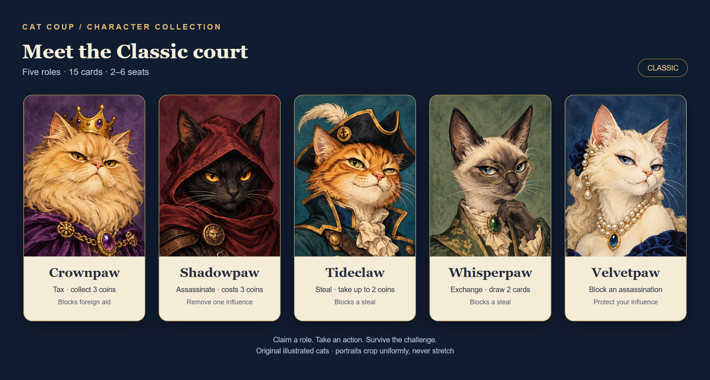
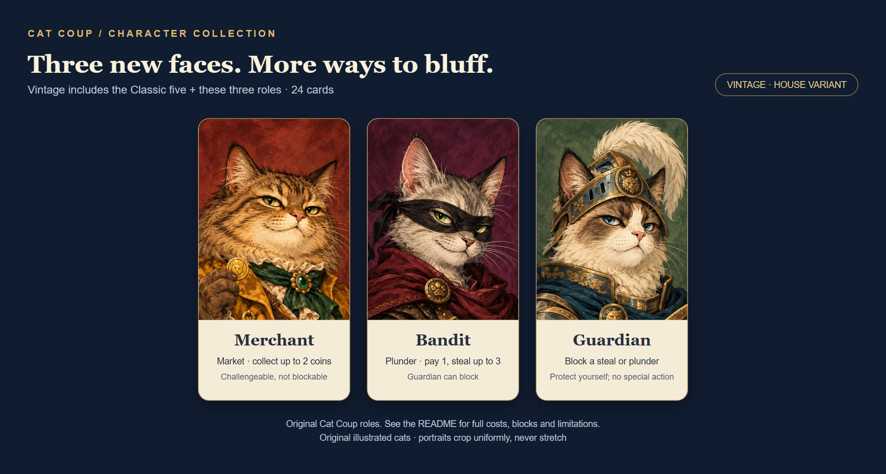
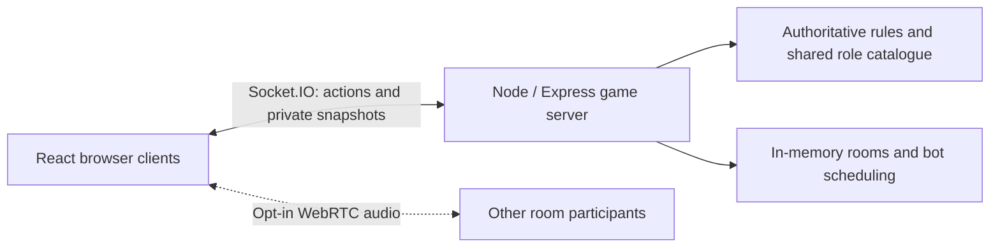

# Cat Coup 🐾

**A little charm. A bold bluff. One cat left standing.**

An online, cat-themed fan adaptation of **Coup** for **2–6 seats**, with private room codes, practice bots, a circular table and optional push-to-talk voice. Play the five-role Classic court or try Vintage, an original eight-role house variant.

[Play Cat Coup](https://cat-coup.jukrachai-crybaby.space/) · [Run locally](#run-locally) · [Character cards](#the-character-cards) · [Deployment guide](DEPLOYMENT.md)

## The character cards

### Classic — the original five



| Role | Action | Block |
| --- | --- | --- |
| **Crownpaw** | **Tax:** collect up to 3 coins from the treasury. | Foreign aid. |
| **Shadowpaw** | **Assassinate:** pay 3 coins to make a target lose one influence. | — |
| **Tideclaw** | **Steal:** take up to 2 available coins from one opponent. | Steal against yourself. |
| **Whisperpaw** | **Exchange:** draw 2 cards, choose your hidden hand and return the rest. | Steal against yourself. |
| **Velvetpaw** | — | Assassination against yourself. |

These are Cat Coup’s own character display names; the five-role rules are unchanged. Renaming characters is not a legal clearance or a change to the credits below.

Classic uses **15 cards: three of each role**. Role claims and blocks can be challenged. Income, foreign aid and coup are also available; coup costs 7 coins and becomes mandatory when you hold 10 or more coins.

### Vintage — all five Classic roles, plus three new cats



| Additional role | Ability |
| --- | --- |
| **Merchant** | **Market:** collect up to 2 coins from the treasury. The claim can be challenged; the action cannot be blocked. |
| **Bandit** | **Plunder:** pay 1 coin to the treasury, then steal up to 3 available coins from one opponent. Only the target can block, by claiming Guardian. A successful block still spends the fee; a caught Bandit bluff refunds it. |
| **Guardian** | Block Tideclaw’s Steal or Bandit’s Plunder against yourself. The block can be challenged. No special action; does not block assassination. |

Vintage uses **24 cards: three of each of the eight roles**. Both modes start with two influences per player and share a 50-coin treasury. In a two-player game, the starting player begins with 1 coin and the other with 2; otherwise everyone begins with 2 coins.

**Vintage is an original house variant, not an official Coup expansion.** Its larger deck changes role probabilities, and competitive balance has not been established. The host chooses the mode in the lobby; changing it clears human readiness. Mode stays fixed during a game and carries into the rematch lobby.

The original five painted portraits are preserved. The three additional cats use matching storybook artwork. See [artwork provenance](public/assets/PROVENANCE.md). These sheets reuse the game’s delivered portraits; they are documentation images, not additional game downloads.

## Pull up a chair

1. Open [the game](https://cat-coup.jukrachai-crybaby.space/), choose a nickname and **Create a room**.
2. Share the invite link or six-character room code. Friends must connect to the same server.
3. Choose **Classic** or **Vintage**. The host can add practice bots, up to six total seats.
4. Everyone readies up; the host deals. Take actions, challenge claims and protect your hidden influences.
5. The last player with influence wins. Open a rematch lobby to play again.

Your seat sits at the bottom of the circular table. Public coins, remaining influence and the active turn are visible to everyone; your hidden hand is private. Portraits around the table are decorative avatars and do not disclose hidden roles.

**Practice bots** ready automatically, use their own redacted view, make truthful blocks and handle influence/exchange decisions. Their basic strategy uses income, tax, coup and Merchant’s Market when held. They are practice opponents, with no difficulty settings or voice participation.

### Host controls

The host can select **Close room** in the lobby or **End game & close room** during play. A confirmation dialog warns that everyone returns home and progress is discarded. Cancel keeps the room intact.

Closure works even if a disconnected player has paused the table or the host has been eliminated. The server removes only that room, cancels its bot timer and invalidates its code and session tokens. Connected clients clear their saved seat and release room voice. Closing a room does not award a winner.

### Hold T to talk

Select **Enable voice**, allow microphone access, then **hold T** to speak and release it to mute. On touchscreens, hold the microphone button. Typing in an input does not transmit; switching windows or hiding the page mutes. Disabling voice, disconnecting or leaving/closing a room stops microphone capture.

Voice is opt-in **WebRTC peer-to-peer audio**. Socket.IO carries room-scoped signaling; the Node server does not record or relay audio. HTTPS or localhost, browser permission and a compatible microphone are required. Peer connections can expose network addresses to other participants.

Only STUN is configured by default; **there is no TURN relay**. Voice can fail on restrictive networks. Cloudflare Tunnel carries the website and game connection, not WebRTC audio.

## Run locally

Tested with **Node.js 24.22.1** and **pnpm 11.25.0**.

```sh
pnpm install --frozen-lockfile
pnpm build
pnpm start
```

Open [localhost:3001](http://127.0.0.1:3001). Use another browser profile or private window for a second local player. Refreshing the original tab restores its seat while the room exists.

```sh
pnpm dev          # Vite on 5173; game server on 3001
pnpm test         # Rule and Socket.IO tests
pnpm build        # Type-check and build client/server
pnpm perf:budget  # Check built JS, CSS and artwork budgets
```

The server defaults to `HOST=127.0.0.1` and `PORT=3001`. For a trusted LAN, set `HOST=0.0.0.0`, allow the port in the host firewall and share `http://<host-LAN-IP>:3001`. A room code does not connect independent server instances. Remote microphone access requires HTTPS.

## How it works



The public deployment uses a Windows Node process behind Cloudflare Tunnel. Docker/Compose and CI/release tooling are included for deployment preparation; **Docker migration is paused**, and the repository does not imply automatic production promotion. See [DEPLOYMENT.md](DEPLOYMENT.md) for release, drain and rollback procedures. Keep tunnel credentials and environment secrets outside Git.

| Location | Responsibility |
| --- | --- |
| `server/game.ts` | Rules, state transitions and player-specific views. |
| `server/roles.ts` | Shared roles, actions and block permissions. |
| `server/index.ts` | Rooms, socket authorization, reconnection and bots. |
| `src/main.tsx` | Lobby, table, hands and player controls. |
| `src/Portrait.tsx` | Uniform portrait scaling and sprite-panel isolation. |
| `src/spacing.css` | Shared 4, 8, 16, 24, 32, 40 and 48px spacing tokens. |
| `tests/` | Rule/socket tests and browser verification scripts. |

## Verification and limits

The current rule/socket suite contains **25 tests**, covering complete games, card/coin conservation, private views, mode-specific actions, readiness, reconnects and host-only room closure. Browser scripts cover responsive layouts, private hands, mode selection, synthetic two-peer voice and closing a room with microphone cleanup.

Browser checks require a separately installed Playwright package and Edge. Set `PLAYWRIGHT_MODULE` to that package path and `BROWSER_CHANNEL=msedge` when needed. Each script specifies its isolated test-server port; review it before running. Voice tests use synthetic microphones, never a real device. Local synthetic WebRTC checks do not establish compatibility with every Internet connection.

Built asset budgets are checked by `pnpm perf:budget`. See [PERF.md](PERF.md), the [public loading audit](docs/performance/2026-10-28-public.md) and [card/spacing verification](docs/design/card-spacing-implementation-2026-10-28.md) for measurements and their limitations. Portraits crop uniformly rather than stretch, and paired hands support viewports down to 320px.

Known limits:

- **Rooms are stored in memory. Restarting the server clears them.** There are no accounts, database persistence, public matchmaking or spectator seats.
- A disconnected living human pauses play and bots until they return. There is no timeout or bot takeover; the host may explicitly close the room.
- Reconnection depends on the original browser session. Offline lobby seats remain reserved until their owners return and leave, the host closes the room, or the room expires.
- All-offline idle lobbies and finished games expire after six hours. Unfinished games remain until explicitly closed or the server restarts; release draining treats them as active.
- A challenged claimant automatically proves the role if they hold it. Voluntary concession while holding that role is not offered.
- Vintage balance and voice across restrictive NAT/firewall environments remain unverified.

## Credits

Original game design: **Rikki Tahta / La Mame Games**. Rules reference: [Coup rulebook](https://www.qugs.org/rules/r131357.pdf).

Cat Coup is an independent fan prototype with original cat illustrations and interface text. It does not include the original game’s illustrations or branding. [Artwork sources and preparation](public/assets/PROVENANCE.md) document the delivered assets.
